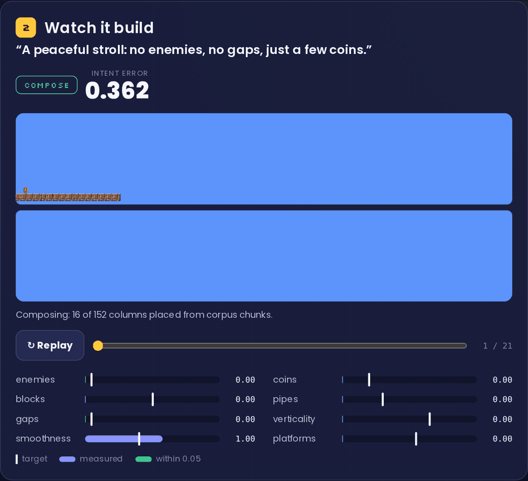
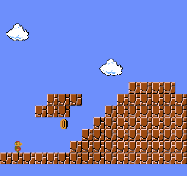
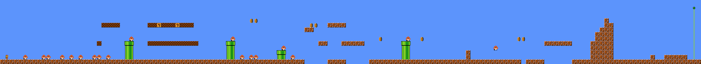
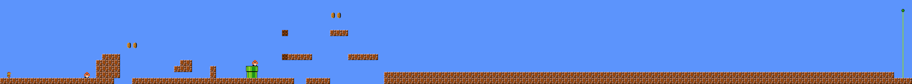
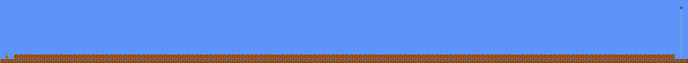
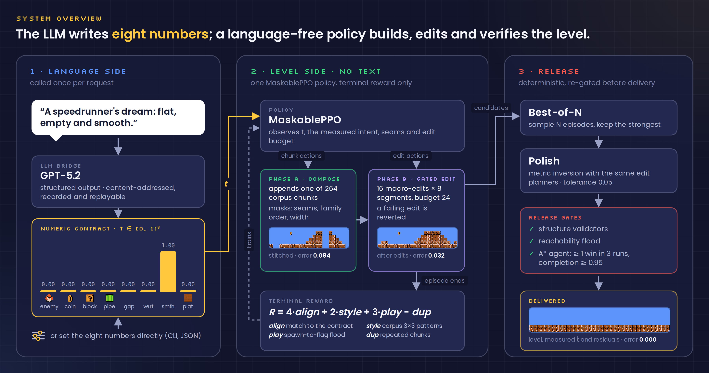
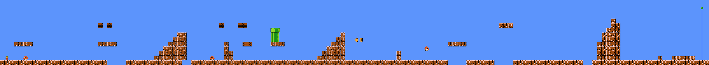
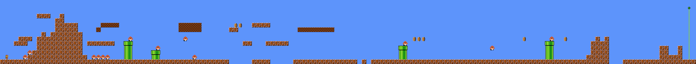
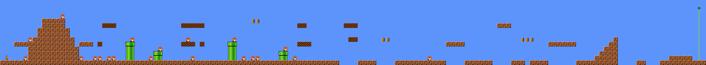
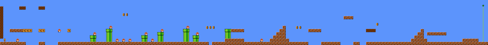

<div align="center">

## Did You Get the Level You Asked For?

**Bridging LLMs and PCGRL for *Super Mario Bros.* level generation: an LLM turns a request into eight numbers, a MaskablePPO policy composes and edits the level, and an A\* agent must finish it before release.**

[](https://github.com/brunolemosdl/intent-pcgrl/stargazers)
[](https://github.com/brunolemosdl/intent-pcgrl/network/members)
[](https://github.com/brunolemosdl/intent-pcgrl/issues)
[](https://github.com/brunolemosdl/intent-pcgrl/graphs/contributors)
[](https://github.com/brunolemosdl/intent-pcgrl/commits)

[](https://github.com/brunolemosdl/intent-pcgrl/actions/workflows/ci.yml)
[](https://brunolemosdl.github.io/intent-pcgrl-demo/)
[](https://brunolemosdl.github.io/intent-pcgrl-demo/assets/poster.pdf)
[](#citation)
[](https://www.python.org/)
[](https://sb3-contrib.readthedocs.io/)
[](https://gymnasium.farama.org/)
[](https://github.com/amidos2006/Mario-AI-Framework)
[](LICENSE)

[Demo](#try-it-in-the-browser) • [Request to Level](#from-request-to-level) • [System](#system-diagram) • [Overview](#experiment-overview) • [Levels](#generated-levels) • [Results](#artifact-results) • [Quick Start](#quick-start) • [Training](#training-workflows) • [Evaluation](#evaluation-workflows) • [Artifacts](#artifact-layout) • [Validation](#validation) • [Citation](#citation)

</div>

This repository is the research artifact of the **AIIDE 2026** paper:

> **Did You Get the Level You Asked For? Bridging LLMs and PCGRL for Mario Level Generation**
> Bruno Lemos and Luiz Chaimowicz · Universidade Federal de Minas Gerais (UFMG)

A language model translates a free-form request into eight numeric intent targets, while a
language-independent MaskablePPO policy composes corpus chunks and applies a constrained set
of macro-edits. Deterministic polish reduces the remaining metric error, and an external Mario
AI Framework A\* agent provides the final playability judgment. Because the LLM never places a
tile, translation error and generation error are measured separately.

The repository contains the source code, corpus, processed chunk library, released policies,
recorded translations, per-level outputs, aggregate reports and tests needed to reproduce the
paper. Development-only runs, intermediate checkpoints, logs and caches are excluded.

## Try It in the Browser

The [**interactive demo**](https://brunolemosdl.github.io/intent-pcgrl-demo/) replays levels
generated by the released policy: ask for a level, watch the episode compose and edit it, then
play the result. Its source lives in
[intent-pcgrl-demo](https://github.com/brunolemosdl/intent-pcgrl-demo).

<div align="center">
  <a href="https://brunolemosdl.github.io/intent-pcgrl-demo/"></a>
</div>

<table align="center">
  <tr>
    <td width="68%"></td>
    <td width="32%"></td>
  </tr>
  <tr>
    <td align="center"><sub><b>One episode.</b> “A peaceful stroll: no enemies, no gaps, just a few coins.”, decision by decision.</sub></td>
    <td align="center"><sub><b>Release gate.</b> The A* agent finishing the same level.</sub></td>
  </tr>
</table>

## From Request to Level

Corpus composition alone is *material-bound*: none of the 241 middle chunks is flat and empty,
so a request for zero enemies and zero gaps cannot be met by recombination. The edit phase and
polish close that gap while keeping the level valid and reachable.

| Request | Level |
| --- | --- |
| “a hilly level with coins, blocks and platforms” · mean intent error **0.03** |  |
| “flat, empty, maximally smooth”, compose only · error **0.16** |  |
| same level after gated edits and polish · error **0.000** |  |

## System Diagram

The figure below summarizes the full scientific flow, from language or direct vector
input to intent-conditioned generation, polish, validation, and the final error report.

<div align="center">
  
</div>

The LLM is input-side only: it never places tiles and is not involved in validation.
Generation, editing, metric computation, polish, and playability checks remain fully
deterministic with respect to their configured seeds and recorded inputs.

## Experiment Overview

| Component | Paper-aligned implementation |
| --- | --- |
| Game | *Super Mario Bros.*, 152 × 14 tile levels |
| Corpus | VGLC overworld levels; 15 SMB levels provide composition material and 25 levels define density caps |
| Chunk library | 264 annotated chunks, 16 columns wide, extracted with stride 8 |
| Intent space | Eight normalized density and structural properties in `[0, 1]` |
| Generator | MaskablePPO with two 256-unit hidden layers and `gamma = 1` |
| Composition | Hard masks enforce family order, width arithmetic, and seam physics |
| Editing | 193 discrete segment-level actions, including `STOP`, with a budget of 24 edits |
| Reward | Terminal intent alignment, corpus style, flood reachability, and duplication control |
| Selection | Single rollout or best-of-N candidates under a shared target |
| Polish | Up to three deterministic metric-inversion passes with tolerance `0.05` |
| Final judge | Mario AI Framework A* agent; accepted levels require at least `0.95` completion |
| Language bridge | Structured OpenAI-compatible output with content-addressed record/replay |
| Released policies | Three 1.5M-step seeds, one 10M-step policy, and one compose-only ablation |

### What the system is doing

At a high level, the environment builds an intent-conditioned Mario level in two phases:

- a target is supplied directly or translated from natural language into eight values;
- the policy selects corpus chunks under masks for family order, width, seam geometry,
  duplicate control, and intent-budget overshoot;
- the stitched level enters a macro-edit phase that can change enemies, collectibles,
  blocks, pipes, gaps, terrain relief, smoothness, and elevated platforms;
- every edit is reverted immediately if it introduces a structural or reachability
  violation;
- the terminal reward evaluates the complete edited level once per episode;
- best-of-N selection retains the strongest candidate before deterministic polish;
- structural checks, the calibrated flood, and the external A* agent gate the output;
- diagnostics report the requested target, measured vector, and residual error.

### Composition and edit phases

The composition phase preserves corpus structure by choosing from the annotated VGLC
library. The edit phase addresses targets outside that material's viability manifold,
such as exact-zero enemies or gaps. Both phases share one discrete policy and one
terminal objective; editing does not introduce a separate learned model.

### Reward structure

The terminal reward combines:

- mean and worst-dimension intent alignment;
- truncated pattern KL divergence against the corpus style distribution;
- calibrated flood reachability;
- duplicate-chunk control;
- structural validity through hard acceptance gates.

The reward is unchanged for the compose-only ablation. Its performance difference
therefore isolates the contribution of the edit action space rather than a different
objective.

### Intent dimensions

| Dimension | Controlled property |
| --- | --- |
| `enemy_density` | enemy count relative to the corpus-derived cap |
| `coin_density` | coin count relative to the corpus-derived cap |
| `interactive_block_density` | bricks and question/used blocks relative to their cap |
| `pipe_density` | pipe count relative to the corpus-derived cap |
| `gap_difficulty` | width-weighted traversable gaps |
| `verticality` | amplitude of the reachable path envelope |
| `path_smoothness` | mean step variation along the path envelope |
| `platform_usage` | fraction of reachable elevated support columns |

## Generated Levels

The examples below were produced by the released final policy under distinct intent
targets. They are shown at full level width so differences in density, geometry, and
traversal structure remain visible.

<table align="center">
  <tr>
    <td width="50%">
      
    </td>
    <td width="50%">
      
    </td>
  </tr>
  <tr>
    <td align="center"><sub><b>Sparse intent</b></sub></td>
    <td align="center"><sub><b>High verticality</b></sub></td>
  </tr>
</table>

<table align="center">
  <tr>
    <td width="50%">
      
    </td>
    <td width="50%">
      
    </td>
  </tr>
  <tr>
    <td align="center"><sub><b>Hard intent</b></sub></td>
    <td align="center"><sub><b>Balanced intent</b></sub></td>
  </tr>
</table>

All gallery levels come from the released 10M-step policy using the full best-of-5 plus
polish pipeline and passed the external playability gate.

## Failure Modes

The artifact retains negative results and unresolved metric tensions instead of hiding
them behind aggregate reward.

| Failure mode | Observed behavior | Mitigation or reported limit |
| --- | --- | --- |
| Geometric flood mismatch | Flood reachability can label levels playable even when the A* agent dies to enemies or timing | Final acceptance always requires the external gameplay judge |
| Smoothness–structure tension | Requested pipes and elevated platforms create path-envelope steps | Polish reports the residual; final polished smoothness MAE is `0.141` |
| Material-bound composition | Compose-only cannot remove corpus features at hostile extremes | The validated edit phase reduces extreme-suite error from `0.111` to `0.078` |
| Medium-tier verticality | The 1.5M-step policies under-use terrain edits | The 10M-step raw policy passes verticality with MAE `0.073` |

## System Matrix

| System | Family | In paper-first path | Repository role |
| --- | --- | :---: | --- |
| `random_legal` | stochastic baseline | Yes | Uniform choices under the same legal action masks |
| `corpus_replay` | corpus baseline | Yes | Re-stitches source-level segment sequences |
| `greedy_intent` | heuristic search | Yes | Chooses the locally strongest intent match |
| `markov` | statistical baseline | Yes | Bigram chunk transitions learned from the corpus |
| `beam_search` | search baseline | Yes | Width-8 search scored by the same terminal reward |
| `ppo` | reinforcement learning | Yes | Single masked policy rollout |
| `ppo_best_of_n` | reinforcement learning | Yes | Shared policy with candidate selection |
| `ppo_best_of_n_polished` | full pipeline | Yes | Best-of-N followed by deterministic polish |

## Benchmark and Ablations

The stored evaluation protocol covers the complete experimental path:

| Study | Protocol | Stored output |
| --- | --- | --- |
| Flood calibration | 120 levels across jump-height/reach settings | `artifacts/reports/calibration/` |
| Baseline ruler | five non-RL systems over 36 evaluations each | `artifacts/reports/comparison/e3_ruler/` |
| Multi-seed policy comparison | medium policies at seeds 42, 1042, and 2042 | `artifacts/reports/comparison/e4_seed*/` |
| Controllability | 8 dimensions × 7 targets × 10 levels | `artifacts/reports/controllability/` |
| Language translation | 46 scored descriptions plus bootstrap intervals | `artifacts/experiments/llm_eval/e7a_v2/` |
| Impact monotonicity | 5 language bands × 3 seeds for four density dimensions | `artifacts/experiments/monotonicity/e7b_final10m/` |
| Training factorial | `2^4 × 2 = 32` quick-tier retrainings | `artifacts/experiments/factorial_composer_twophase/` |
| Inference factorial | all `2^3` language/generation cells | `artifacts/experiments/factorial_inference_final10m/` |
| Edit/polish ablation | standard and six-corner extreme suites | `artifacts/reports/comparison/e8_*/` |

## Artifact Results

The tables below are a compact index of the checked-in results, not a replacement for
the manuscript analysis. Full values, confidence intervals, pairwise tests, and
per-level records are available under [`artifacts/`](artifacts/).

| System | Terminal reward | Mean intent error | Evaluations |
| --- | ---: | ---: | ---: |
| Beam search, width 8 | 6.870 | 0.138 | 36 |
| Medium PPO, seed 42 | 7.819 | 0.076 | 36 |
| Medium PPO, best-of-5 | 7.899 | 0.062 | 36 |
| Final PPO, 10M steps | 8.117 | 0.035 | 36 |
| Final PPO, best-of-5 | 8.141 | 0.032 | 36 |
| Final PPO, best-of-5 + polish | 8.047 | 0.029 | 36 |

Additional checked-in outcomes:

- the final raw policy passes all `8/8` controllability sweeps;
- the recorded language benchmark reaches `0.0529` mean translation error over 46
  scored descriptions;
- the extreme-target two-phase system reaches `0.078` mean intent error, compared with
  `0.111` for compose-only and `0.180` for beam search;
- flood-versus-A* calibration, training and inference factorials, language monotonicity,
  and edit/polish ablations are included.

Start with [`artifacts/reports/master_table.md`](artifacts/reports/master_table.md) and
[`artifacts/experiments/llm_eval/e7a_v2/summary.json`](artifacts/experiments/llm_eval/e7a_v2/summary.json).

## Quick Start

### Requirements

- Linux or macOS;
- Python 3.11 or 3.12;
- JDK 17 or newer;
- GNU Make;
- network access for initial dependency installation only.

### Bootstrap

```bash
make setup
make bridge
```

The corpus, sprites, processed library, and released checkpoints are already included.
They do not need to be downloaded or regenerated for the example below.

### Generate with the released final policy

```bash
.venv/bin/python -m pcgrl.app.commands generate \
  --checkpoint artifacts/models/final10m_seed42/policy_final.zip \
  --target-json '[0.3, 0.4, 0.5, 0.3, 0.4, 0.5, 0.5, 0.5]' \
  --seed 42 \
  --config configs/mario.yaml
```

Generation writes JSON, ASCII, and PNG outputs to a timestamped directory. The external
A* gate may take longer than policy inference because it plays candidate levels.

### Generate from language

Copy the environment template, configure an OpenAI-compatible endpoint, and provide a
description:

```bash
cp .env.example .env

.venv/bin/python -m pcgrl.app.commands generate \
  --checkpoint artifacts/models/final10m_seed42/policy_final.zip \
  --prompt 'a difficult vertical level with many enemies and few coins' \
  --seed 42 \
  --config configs/mario.yaml
```

Known descriptions can be replayed offline from
[`data/descriptions/recorded_store.json`](data/descriptions/recorded_store.json). A live
API call occurs only when the selected mode permits it and the description is absent
from the store.

## Training Workflows

### Rebuild the corpus-derived inputs

```bash
make prepare
make library
```

These stages reproduce the corpus profile, pattern distributions, annotated chunk
library, and intent viability map under `data/processed/mario/`.

### Train a paper-aligned policy

```bash
make train TRAINING=medium
```

The principal tiers are:

| Tier | Environment steps | Purpose |
| --- | ---: | --- |
| `quick` | 300,000 | training-factorial cells and local workflow checks |
| `medium` | 1,500,000 | three-seed comparison and ablation policies |
| `final` | 10,000,000 | final seed-42 policy |

Training tiers merge [`configs/mario.yaml`](configs/mario.yaml) with the matching file
under [`configs/experiments/`](configs/experiments/). Every run persists its resolved
configuration and provenance metadata beside the checkpoint.

### Run the complete workflow

```bash
make run TRAINING=quick
```

This executes preparation, library extraction, training, generation, and summary
creation in order. Use `TRAINING=medium` or `TRAINING=final` for the reported budgets.

## Evaluation Workflows

### Baseline and policy comparison

```bash
make compare \
  SYSTEMS=ppo,beam_search \
  CHECKPOINT=artifacts/models/final10m_seed42/policy_final.zip
```

### Per-dimension controllability

```bash
make controllability \
  CHECKPOINT=artifacts/models/final10m_seed42/policy_final.zip
```

### Flood-versus-A* calibration

```bash
make calibrate N_LEVELS=120
```

### Training factorial

```bash
make experiment \
  SPEC=configs/experiments/factorial_composer.yaml \
  STAGE=analyze
```

The evaluation commands emit machine-readable CSV/JSON data and compact Markdown
summaries. Stored language analyses can be inspected without credentials or live API
calls.

## Artifact Layout

```text
artifacts/
├── models/
│   ├── medium_seed42/               1.5M-step policy
│   ├── medium_seed1042/             1.5M-step policy
│   ├── medium_seed2042/             1.5M-step policy
│   ├── final10m_seed42/             10M-step policy
│   └── compose_only_medium_seed42/  edit-phase ablation
├── reports/
│   ├── calibration/                 flood-versus-A* calibration
│   ├── comparison/                  baselines, policies, and ablations
│   ├── controllability/             raw and polished sweeps
│   ├── gallery/                     qualitative final-policy levels
│   └── master_table.{csv,md}        consolidated paper-facing metrics
└── experiments/
    ├── factorial_composer_twophase/ 2^4 training-factorial summaries
    ├── factorial_inference_final10m/ 2^3 inference-factorial summaries
    ├── llm_eval/e7a_v2/             translation benchmark
    └── monotonicity/e7b_final10m/   language-impact monotonicity
```

### What to inspect first

- `config.snapshot.yaml`: exact merged configuration associated with each policy;
- `comparison.csv`: per-level evaluation observations;
- `summary.json`: aggregate metrics and bootstrap intervals;
- `pairwise.json`: permutation tests between systems;
- `controllability.json`: MAE and Spearman correlation for every intent dimension;
- `master_table.md`: compact cross-experiment index.

## Repository Structure

```text
intent-pcgrl/
├── artifacts/              released policies and paper-facing results
├── assets/
│   ├── mario/              rendering assets
│   └── readme/             README figures
├── configs/                runtime and experiment configurations
├── data/
│   ├── descriptions/       language benchmark and record/replay store
│   ├── processed/          chunk library and corpus statistics
│   └── raw/                VGLC Mario corpus
├── packages/
│   ├── pcgrl-app/          CLI, pipelines, evaluations, and language bridge
│   ├── pcgrl-bridge/       Python adapter for the gameplay judge
│   ├── pcgrl-core/         contracts, settings, tiles, and chunk types
│   ├── pcgrl-learning/     MaskablePPO training and generation
│   ├── pcgrl-rendering/    ASCII and PNG rendering
│   └── pcgrl-runtime/      environment, metrics, edits, polish, and validators
├── scripts/                corpus, asset, bridge, and pipeline helpers
├── tests/                  unit and integration suites
└── vendor/mario/           Mario AI Framework source and bridge entry point
```

## Setup

### Environment variables

Start from the tracked template:

```bash
cp .env.example .env
```

| Variable | Required | Purpose |
| --- | --- | --- |
| `OPENAI_API_KEY` | live language calls only | default OpenAI-compatible credential |
| `GEMINI_API_KEY` | optional | example alternative OpenAI-compatible endpoint |
| `PCGRL_REPO_ROOT` | no | explicit repository root when running outside the checkout |
| `MPLCONFIGDIR` | no | Matplotlib cache location; Make defaults to `.cache/matplotlib` |

Secrets belong only in the ignored `.env` file. Numeric-target generation and replayed
language requests do not require an API key.

### Reconstruct optional upstream inputs

The tracked inputs are ready to use. These targets are provided only for reconstruction:

```bash
make assets
make vglc
```

### Docker

```bash
docker build -t intent-pcgrl .
docker run --rm intent-pcgrl --help
```

The image installs the workspace packages and builds the Java gameplay bridge.

## Validation

```bash
make check
make test-integration
```

`make check` runs Ruff, strict per-package mypy, CLI dry-runs, and 498 unit tests.
The integration suite adds six tests over the real processed library and the Java bridge
(the bridge test is skipped until `make bridge` has built the JAR). Both suites run on every
push in [GitHub Actions](.github/workflows/ci.yml).

Useful individual targets:

```bash
make lint
make typecheck
make command-dry-runs
make test-unit
make test-integration
```

## Reproducibility Notes

- released seeds are explicit in model-directory names and `seed.txt` files;
- checkpoint ZIPs contain no local paths or user metadata;
- language translations are content-addressed and replayable;
- result tables retain per-level records, not only aggregate values;
- the Java JAR is rebuilt locally from the tracked source;
- language calls used `gpt-5.2` with prompt version `v1`, recorded on June 11, 2026 (UTC);
  every experiment replays those vectors offline.

## Related Repositories

| Repository | Content |
| --- | --- |
| [intent-pcgrl-demo](https://github.com/brunolemosdl/intent-pcgrl-demo) | Interactive browser demo and the AIIDE 2026 poster |

## Contributing

Bug reports and pull requests are welcome. See [CONTRIBUTING.md](CONTRIBUTING.md) for the
development setup, the checks a change must pass, and the commit style.

## Citation

If you use this code or its artifacts, please cite:

```bibtex
@inproceedings{lemos2026level,
  title     = {Did You Get the Level You Asked For? Bridging {LLMs} and {PCGRL} for Mario Level Generation},
  author    = {Lemos, Bruno and Chaimowicz, Luiz},
  booktitle = {Proceedings of the AAAI Conference on Artificial Intelligence and Interactive Digital Entertainment (AIIDE)},
  year      = {2026}
}
```

GitHub also reads [CITATION.cff](CITATION.cff) and offers the same entry under “Cite this repository”.

## Acknowledgments

This research was partially funded by the Coordination for the Improvement of Higher Education
Personnel (CAPES), the National Council for Scientific and Technological Development (CNPq),
and the Minas Gerais Research Foundation (Fapemig).

## License

Repository code is released under the [MIT License](LICENSE). The VGLC corpus, Mario
rendering assets, and vendored Mario AI Framework files remain subject to their
respective upstream terms.
